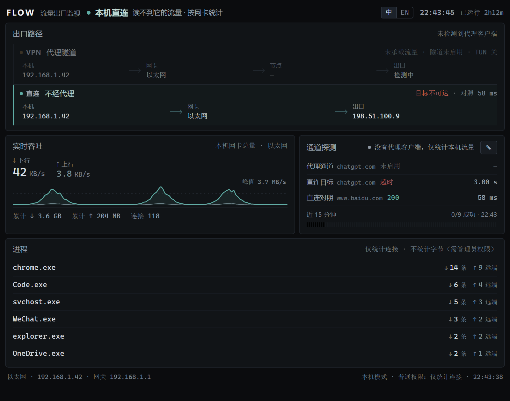
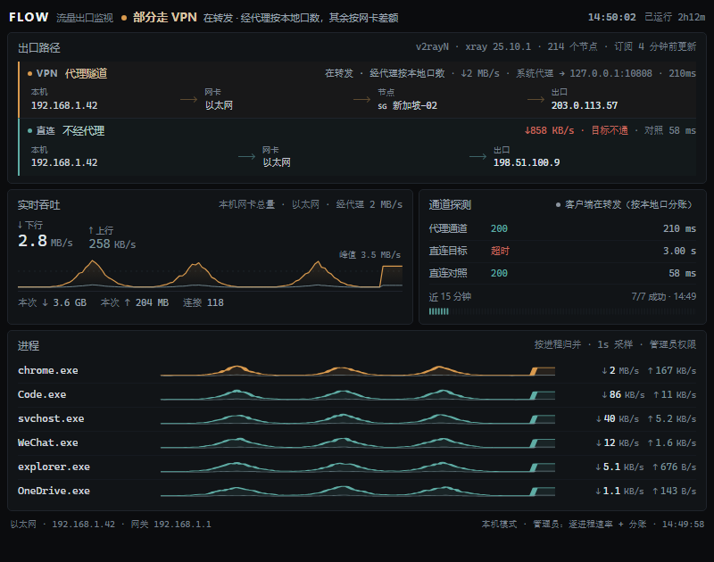
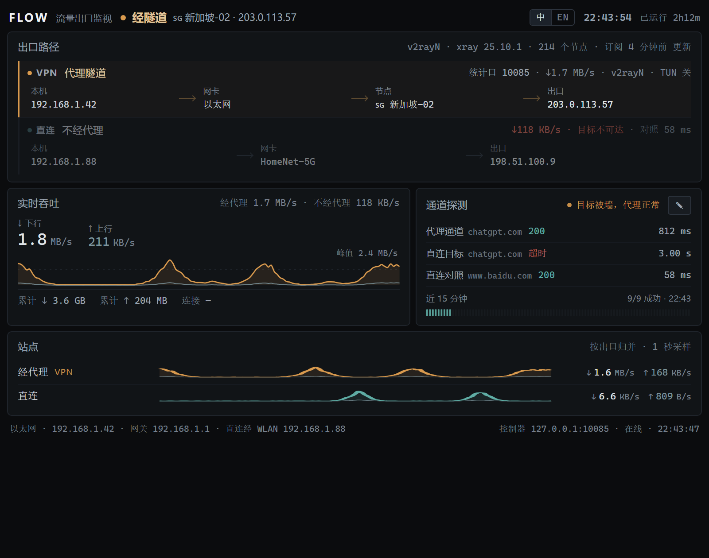

<h1 align="center">FLOW · Egress Monitor</h1>

<p align="center"><sub>Direct or tunnelled · which adapter · which public IP the traffic leaves from</sub></p>

<p align="center">
  <a href="https://github.com/7icence1Z/flow-tracking/releases"></a>
  <a href="https://www.npmjs.com/package/@7icence1z/flow-tracking"></a>
  <a href="LICENSE"></a>
  
  
  
  
</p>

<p align="center">
  <a href="README.md">中文</a> · <a href="CHANGELOG.md">Changelog</a>
</p>

<p align="center"></p>
<p align="center"><sub>A 13-second loop, rendered from the real interface; all figures are fictitious and reproducible with <code>tools/mock_state.py</code>.<br><a href="https://github.com/7icence1Z/flow-tracking/releases/latest">Full 2K version (25 seconds, including host mode and per-process rates)</a></sub></p>

## Overview

This is a small, locally run monitoring panel that answers one question: **is the traffic right now going direct or through a tunnel, which adapter does it use, and which public IP does it leave from?**

Three data lines are tracked at once — adapter total, via proxy, and not via proxy — and sites are coloured by their actual egress. When no client is running, accounting continues from the adapter and process tables; when a client exposes no statistics endpoint, samples are taken from its local proxy port. Windows 10/11 only, Python standard library only, no third-party dependencies, no telemetry. Current version **v0.1.4** (2026-11-13); see the [changelog](CHANGELOG.md).

## Install

```powershell
npm i -g @7icence1z/flow-tracking     # Node 16+, used only as a launcher
flow                                   # start the collector and open the panel
```

| Command | Purpose |
|---|---|
| `flow` / `flow stop` | Start / stop the collector |
| `flow status` (`flow stat`) | Print mode, verdict, diagnosis, split and egress on one screen without opening the panel; exits with code 1 when the collector is not running |
| `flow admin` | Start elevated. Per-process rates are visible to administrators only; `flow` itself never requests elevation |
| `flow --port 7718` / `-h` / `-v` | Alternative port (`flow status -p 7718` likewise) / usage / version |
| `npx @7icence1z/flow-tracking@latest` | Run once without installing; omitting `@latest` reuses a stale version from the npx cache |

Requirements: Python 3.10 or newer (standard library only) and either Edge or Chrome. The window opens in `--app=` mode under a separate profile and is not duplicated when already open; `start.ps1` also accepts `-Port` / `-Width` / `-Height` / `-DefaultProfile`. Node is not needed without npm:

```powershell
powershell -ExecutionPolicy Bypass -File .\start.ps1     # or double-click start.cmd; -Stop to stop
```

Updates are handled by the package manager; there is no `flow update` subcommand — run `npm i -g @7icence1z/flow-tracking@latest`, or `git pull` in a clone.

**Per-process rates require administrator rights**: run `flow stop`, then `flow admin` (or run `start.cmd` as administrator). An elevated instance will not take over a collector already running unelevated, so stop it first; see [host mode](#without-a-client-host-mode).

## Panel

- **Verdict bar**: tunnelled / partly tunnelled / direct / direct on this machine / tunnel statistics unreadable. The subtitle shows the node name and tunnel egress IP, with a small note on the evidence used (system proxy registry, controller mode, client identity)
- **Two lanes**: local IP → adapter → node → egress. The adapter is chosen by the kernel route (a `connect()` to the target, reading back the source address), never guessed from adapter names; the right-hand side shows live rates and `承载 17 条 · rule · TUN 关`
- **Throughput and split**: one frame per 0.5 s over a 120 s window (1 s in host mode, which enumerates connections). The total comes from adapter counters (`GetIfTable2`); of `经代理 121 KB/s · 不经代理 8.5 KB/s`, the latter is a **difference-based estimate**. The curve is coloured by the verdict in force at each sample, so amber segments neither vanish nor keep growing after the VPN is switched off — they slide out of the window
- **Probe lanes**: the proxy and the direct path each request the same target, with a domestic control target; failures are classified (DNS / refused / reset / timeout / TLS) and the last 96 results are shown as ticks. The ✎ button on the card header edits target, control target and interval (5–120 s); changes apply on save
- **Diagnosis**: the verdict in the top-right is computed from evidence; hover it to see the supporting evidence
- **Sites**: per-domain ↓↑ rates coloured by actual egress (amber = tunnel, teal = direct); the ＋ domain control writes to `config.json`
- **Language and link state**: a 中 / EN switch in the header (English uses British spelling, remembered per browser, also `?lang=en`); after 6 s without a new frame the header shows `采集器未连接 · 最后 21:03:10` and readings dim to mark them as stale

## Without a client (host mode)

When no client is detected, the panel switches to **host mode**: adapter totals, connection counts and TCP connections merged by process (loopback excluded). If a client is running but its byte counters cannot be read (typically v2rayN with its statistics endpoint disabled), three cases are distinguished:

- The system proxy points at a local port owned by the client → verdict `部分经隧道`, subtitle "forwarding, byte count unreadable". Forwarding is proven, so the panel does not claim that traffic is "not going through the tunnel"
- **With administrator rights** it reads loopback TCP connections from applications to that port for bytes **entering the client** (`split.client`), and the wording becomes "client is forwarding (counted at its local port)", subtitle "counted at its local port, tunnel share unknown". Ingress bytes are not tunnel bytes — the client may forward some traffic directly — so the figure is an upper bound
- When neither can be proven, the verdict is `本机直连` and the reason is limited to "cannot read its traffic"; no claim is made about its behaviour

<p align="center">
  
  
</p>

**Rights determine granularity** — the only thing the user has to choose:

| Item | Standard rights | Administrator |
|---|---|---|
| Adapter total / connections / who talks to whom | ✅ | ✅ |
| Per-process ↓↑ and curves | ❌ connections only | ✅ kernel eStats delta (TCP payload only) |
| Via-proxy / not-via-proxy split | ❌ (client-provided statistics are separate) | ❌ requires a client statistics endpoint; the next row is what is available here |
| Bytes entering the client (via its local port) | ❌ | ✅ loopback proxy-port eStats delta, system-proxy mode only; **ingress ≠ tunnel** |
| Footer | `普通权限 · 仅统计连接` | `管理员：逐进程速率`, plus `+ 经客户端字节` in system-proxy mode |

If eStats returns 5 under standard rights, the panel falls back to connection-only accounting without retrying or inventing numbers (covered by `tools/test_estats.py`); UDP/QUIC traffic is not attributed to process rows. A client that is running but has no node connected is treated the same way.

## Supported clients

Clients are discovered automatically, with nothing to configure: port ownership (`GetExtendedTcpTable`) → `GET /version` to identify the Clash API → configuration located from the kernel command line → node table parsed, each step validated for liveness; a client's identity is discarded when it exits.

| Client | Verdict | Node name | Per-connection | Bytes |
|---|---|---|---|---|
| Clash Verge / Mihomo Party / FlClash / mihomo / provider builds | ✅ | ✅ | ✅ | ✅ per domain |
| sing-box (with `clash_api`) | ✅ | ✅ | ✅ | ✅ per domain |
| v2rayN (Xray core) | ✅ | ✅ from `guiNDB.db` | ❌ | ✅ per outbound |
| Other Xray shells / WireGuard / OpenVPN / Tailscale | ✅ | address when unnamed | ❌ | adapter + egress |
| No client running | ✅ direct | — | ✅ per process | adapter total |

Visibility is labelled honestly as **connection-level** (per domain), **outbound-level** (v2rayN read from `/debug/vars` on its `metrics.listen`, giving only "via proxy" and "direct" rows), **adapter only** or **host-level**; where per-domain data is unavailable the panel says so instead of filling the gap with totals.

<p align="center"></p>

## Diagnostics

Diagnosis proceeds by elimination from the lowest layer upwards, reporting the lowest failing layer first. **Red is reserved for "claims to be in use but is not working"**; "the tunnel is genuinely not in use" is always shown in neutral grey.

There are 15 conclusions: link healthy · target blocked while the proxy works · target needs the tunnel · ⟨adapter⟩ link down · DNS resolution problem · link up but no outside reach · VPN local proxy port not listening · proxy port taken by another program · VPN has no node connected (grey) · VPN refused the connection · ⟨tunnel adapter⟩ link down · DNS failure on the proxy side · VPN tunnel or node failure · client forwarding but byte count unreadable (grey) · local traffic only (grey). Hover a conclusion to see its evidence; `flow status` prints the same verdict.

## How it compares

| Tool | Per-process traffic | Separates tunnelled from direct | Adapter and egress IP | Without a client running |
|---|---|---|---|---|
| [GlassWire](https://www.glasswire.com/userguide/) / [NetLimiter](https://netlimiter.com/docs/using-with-vpns) (commercial) | ✅ | ❌ tunnelled bytes are counted against the client process, double-counting traffic | ❌ | ❌ |
| [TrafficMonitor](https://github.com/zhongyang219/TrafficMonitor) (with per-process plugin) | ✅ | ❌ | ❌ | ✅ rates only |
| [Clash Verge Rev](https://github.com/clash-verge-rev/clash-verge-rev) connections page | per connection | per connection, via its policy chain | ❌ | ❌ |
| [proxytop](https://www.npmjs.com/package/proxytop) (macOS terminal) | ✅ | ✅ | ✅ interface-level | ❌ macOS only |
| **This project** | ✅ administrator rights | ✅ adapter total − statistics endpoint | ✅ | ✅ host mode |

The difference is not the interface but the split accounting (not-via-proxy bytes derived from the adapter total, with the local proxy port ingress as a labelled upper bound when no statistics endpoint exists), egress attribution (adapter and public egress IP together) and usability with no client at all (no client installed, not started, API off, TUN off). This tool does not replace those: a Clash panel shows connections one by one, while this panel shows the per-process split and the egress point; the two are complementary.

## Implementation notes

Footprint, data sources and self-checks are documented in [docs/IMPLEMENTATION.md](docs/IMPLEMENTATION.md) (Chinese): at rest no child processes are spawned, and process, port-ownership and adapter figures are read straight from kernel tables.

## Configuration and API

| Key | Default | Meaning |
|---|---|---|
| `port` | `7717` | Panel port, bound to `127.0.0.1` only |
| `controller` | `127.0.0.1:7892` | Clash controller address; empty means full auto-discovery |
| `mixed_port` | `127.0.0.1:7890` | Port used for egress-IP probing and the proxy probe lane; v2rayN reads its own configuration, so this is only a fallback |
| `sites` | `["chatgpt.com","openai.com"]` | Domains monitored individually (suffix match); the ＋ domain control edits this list |
| `probe_interval` | `10` | Probe interval in seconds, 5–120 |
| `probe_target` / `control_target` | chatgpt / baidu | Targets for the two probe lanes and the control target for the direct lane; http(s) only, never this machine |

Environment variables: `FLOW_PORT`, `FLOW_CONTROLLER`. Changes take effect after restarting the collector; the three probe settings are the exception and apply as soon as they are saved from the ✎ editor.

Endpoints: `/` (panel), `/api/state` (snapshot JSON), `/api/stream` (SSE, one frame per 0.5 s), `/?poll=1` (polling instead), `POST /api/sites` (`{"action":"add"|"remove","domain":…}`), `POST /api/probe` (`{"target","control","interval"}`, each optional; errors return 400 with a bilingual `msg`). Fields worth knowing in the snapshot:

- `flow`: `""` (Clash family, connection-level) / `xray` (outbound-level) / `host` (host mode)
- `path`: `{active, reason, sysproxy}`, where `active` is `vpn` / `mixed` / `direct` / `down`
- `diag`: `{state, label, why, evidence}`, the last three being `{zh, en}`
- `split`: `{nic, proxy, direct, client, src}`; `src` is `api` (counters from a statistics endpoint) or `loop` (`client` holds ingress bytes, with `proxy` / `direct` set to `null`)

Other keys — `probe` / `tunnel` / `client` / `iface` / `route` / `node` / `egress` / `probes` / `sites` / `extras` / `hist` — are read by name; `tools/peek.py` is a command-line viewer for these endpoints.

## Privacy

The server listens on `127.0.0.1` only, so other hosts on the LAN cannot connect; it reads local state only (registry, process table, adapter counters, configuration, SQLite opened read-only); outward requests are limited to egress-IP probing and probe lanes and carry no identifying information; nothing is logged, collected or uploaded; the panel references no external resources (no CDN, fonts or analytics scripts).

## Layout

```
server.py             collection + HTTP/SSE (standard library, single file)
providers.py          client discovery / configuration parsing / subscription awareness / Xray statistics endpoint
hostflow.py           host mode: GetIfTable2 + GetExtendedTcpTable + GetAdaptersAddresses + admin eStats (pure ctypes)
diag.py               gateway (ICMP) / DNS comparison / per-adapter handshake / error classification
web/index.html        panel (single file, inline CSS/JS, hand-written SVG)
start.ps1, start.cmd  launcher / double-click entry point
package.json, bin/flow.js  npm wrapper (flow only forwards arguments to start.ps1)
config.json           configuration
docs/                 four diagrams (Clash / v2rayN / host / host+elevated)
tools/                peek.py snapshot viewer · mock_state.py demo data · test_* self-checks · check_js.py JS syntax check
```

## FAQ

| Symptom or question | Cause and remedy |
|---|---|
| Does it need administrator rights? | No. Only per-process rates and bytes entering the client need elevation; everything else works with standard rights |
| Process rows show connections but no rates | You are running with standard rights. Run `flow stop`, then `flow admin` |
| Why is "not via proxy" an estimate? | It is by definition adapter total minus via-proxy, includes encryption and frame overhead, reads slightly high, and is not an exact direct-traffic figure |
| Antivirus flags it, or SmartScreen blocks it | Unsigned Python scripts and PowerShell launchers are often blocked. Review the source and run it locally, or open an issue with the `flow status` output |
| The panel does not refresh or keeps showing stale frames | If SSE is intercepted, use `http://127.0.0.1:7717/?poll=1`; if the header says `采集器未连接`, the collector has exited |
| "Local controller not responding" | The client is not running, or its REST API is off (Clash-family clients need "External Control" enabled) |
| VPN is on but the panel says direct | Traffic is not reaching the client: system proxy off, TUN off, or nothing connected to `7890`. Enable "System Proxy" or "TUN" in the client |
| VPN is off but the panel says partly tunnelled | First check the header is not showing `采集器未连接` (that would be a stale frame); `direct` in `flow status` means direct. A leftover client process must satisfy all three of "system proxy on, local port listening, process alive" before forwarding is asserted |
| Site rates stay at `0 B/s` | No traffic in that second, or the site went direct (Clash-family clients do not count direct traffic) |
| Mojibake or launcher syntax errors | `.ps1` files must be UTF-8 with BOM (the files here have one; do not lose it when editing) |
| How to update or remove | Update: `npm i -g @7icence1z/flow-tracking@latest`; remove: `npm rm -g @7icence1z/flow-tracking`. In a clone, run `git pull` |
| macOS or Linux? | No. It relies on the Windows kernel network tables (`GetIfTable2` / `GetExtendedTcpTable` / `GetAdaptersAddresses`) and `netsh` |

## Limitations

- **"Via proxy" comes only from a client statistics endpoint** (Clash `/connections`, Xray `/debug/vars`); **not-via-proxy is always the adapter total minus that figure and is an estimate** (it includes encryption and frame overhead and reads slightly high)
- **"Via its local port" counts ingress bytes, not tunnel bytes**: in system-proxy mode applications connect to the client's local port first, and eStats there only describes traffic entering the client; the client may forward some of it directly, so the figure is an upper bound. The measurement covers system proxy → local port only: TUN mode has no loopback proxy connections, UDP/QUIC does not pass through HTTP proxy ports, and only loopback ports actually in use are counted
- **Host-mode granularity depends on rights**: per-process and per-domain byte counts need kernel eStats or the DNS cache, both requiring administrator rights (unelevated `SetPerTcpConnectionEStats` returns 5; `ipconfig /displaydns` needs elevation); eStats covers **TCP payload** only, and UDP/QUIC appears only in adapter totals
- **Precision depends on the client**: domain-level for Clash, outbound-level for Xray, adapter and egress IP only for WireGuard; totals are never apportioned across domains and presented as exact
- **Diagnosis by elimination, not packet capture**: it separates link / DNS / tunnel / target but cannot distinguish a physical link failure from a router failure, takes about 15 s per round, and records snapshots; the public DNS server is fixed at `223.5.5.5`
- **Coverage**: v2rayN support follows the format of the configuration it generates (verified against constructed samples and a mock statistics endpoint, not every version; if the `guiNDB.db` schema changes, the panel falls back to showing addresses). With no node connected, "not connected" and "connected but unreachable" cannot be told apart, so the most likely reading is shown in grey
- **Read-only, Windows only**: it never changes system proxy settings or routes, and stopping the collector leaves no system state behind

## Licence

Released under the [MIT licence](LICENSE): use, modify and redistribute freely provided the copyright and permission notices are retained; provided as is, without warranty. It contains no third-party code.
