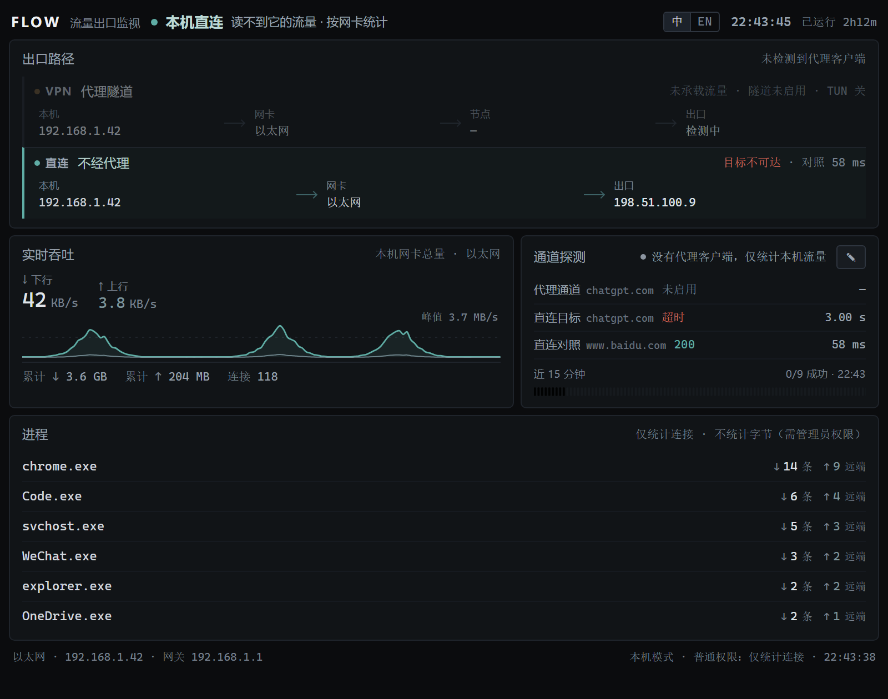
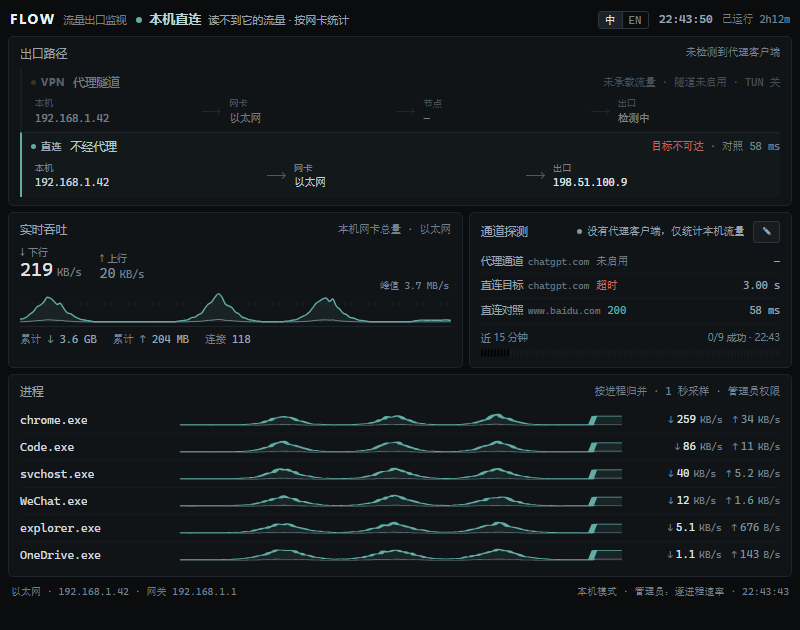

# FLOW · 流量出口监看

<p align="center">
  <a href="https://github.com/7icence1Z/flow-tracking/releases"></a>
  <a href="https://www.npmjs.com/package/@7icence1z/flow-tracking"></a>
  
  
  
  
</p>

本程序是一个仅在本机运行的小型监控面板，用于回答一个问题：**当前时刻的流量是直连还是经隧道转发、经由哪块网卡、从哪个公网 IP 出口。**

系统同时统计三条数据线 —— 网卡总量、经代理、不经代理 —— 并按实际出口为站点着色。未启用 VPN 时，仍依据网卡与进程继续统计；客户端未提供统计接口时，则从其本地代理端口取样。适用于 Windows 10/11，仅使用 Python 标准库，无第三方依赖，无遥测。最新版本 **v0.1.4**（2026-11-13），变更详见 [CHANGELOG](CHANGELOG.md)。

## 安装

```powershell
npm i -g @7icence1z/flow-tracking     # 需要 Node 16+，仅负责调度
flow                                   # 启动采集器并打开面板
```

| 命令 | 作用 |
|---|---|
| `flow` / `flow stop` | 启动 / 停止采集器 |
| `flow status`（`flow stat`） | 在一屏内显示当前状态（模式、判定、诊断、通道、分账、出口），不打开面板，便于排障与提交 issue。采集器未运行时提示 `没在运行（127.0.0.1:7717，ECONNREFUSED）`，并以状态码 1 退出 |
| `flow admin` | 以管理员身份启动。仅管理员可见每进程速率；`flow` 本身不请求提权 |
| `flow --port 7718` | 指定端口（默认 7717），`flow status -p 7718` 同样可用 |
| `flow -h` / `flow -v` | 显示用法 / 版本（读取包内 `package.json`，无需采集器运行） |
| `npx @7icence1z/flow-tracking@latest` | 不安装直接运行一次。省略 `@latest` 将使用 npx 缓存中的旧版本 |

版本更新由包管理器完成，不提供 `flow update` 子命令：全局安装执行 `npm i -g @7icence1z/flow-tracking@latest` 覆盖，从 git 克隆的运行副本执行 `git pull` 即可。不使用 npm 亦可直接运行，此时无需安装 Node：

```powershell
powershell -ExecutionPolicy Bypass -File .\start.ps1     # 亦可双击 start.cmd；-Stop 停止
```

运行前提：Python 3.10 及以上（仅使用标准库），并已安装 Edge 或 Chrome。窗口以 `--app=` 模式启动（无地址栏与标签页），使用独立 profile，不影响日常浏览器；已启动时不会重复打开窗口。`start.ps1` 另支持 `-Port` / `-Width` / `-Height` / `-DefaultProfile`。

**每进程速率需要管理员权限**：先执行 `flow stop`，再执行 `flow admin`（或右键以管理员身份运行 `start.cmd`）。若已有普通权限的采集器在运行，提权启动的实例不会接管它，必须先停止。原因见[「未启用 VPN 时」](#未启用-vpn-时)。


> 图中数据均为虚构值（`192.168.1.x` / `203.0.113.x` / `HomeNet-5G` / `Clash Verge`），由 `tools/mock_state.py` 生成，可复现。

## 面板内容

- **顶部判定**：经隧道 / 部分经隧道 / 直连 / 本机直连 / 隧道统计不可读。副标题显示节点名称与隧道出口 IP，小字标注判定依据（系统代理注册表、控制器模式、客户端身份）
- **两条数据泳道**：本机 IP → 网卡 → 节点 → 出口。网卡依据内核路由判定（对目标地址执行 `connect()`，读取内核返回的源地址），不依据网卡名推测；右侧显示实时速率与 `承载 17 条 · rule · TUN 关`
- **吞吐与分账**：0.5 秒一帧、120 秒曲线（本机模式需枚举连接，为 1 秒一帧）。总量取自**网卡累计字节**（`GetIfTable2`）；`经代理 121 KB/s · 不经代理 8.5 KB/s` 中，后者为差值**估算**（含 UDP/QUIC 的帧开销），仅在客户端提供统计接口时可得。曲线按**各采样点当时的判定**着色：关闭 VPN 后，琥珀色段不会消失，也不会继续增长，只随窗口左移滑出
- **采集器未连接时**：连续 6 秒未收到新帧，顶栏显示 `采集器未连接 · 最后 21:03:10`，判定与读数变淡，表示数据为旧帧而非当前值；恢复后自动消失
- **通道探测**：代理与直连分别请求同一目标，另设国内对照点；失败时给出原因分类（DNS / 拒绝 / 重置 / 超时 / TLS），并显示最近 96 次结果刻度。点击卡头 ✎ 可修改探测目标、对照目标与间隔（5～120 秒），保存后立即生效
- **诊断结论**：右上角结论由证据计算得出，并非固定标题；将鼠标悬停其上可查看支撑证据
- **站点**：按域名归并的 ↓↑ 速率，颜色对应实际出口（琥珀色 = 隧道，青色 = 直连）；底部「＋ 域名」写入 `config.json`
- **界面语言**：顶栏提供 中 / EN 切换（英文采用英式拼写），选择保存在浏览器本地，也支持 `?lang=en`；判定文案由采集器一次输出中英两版

## 未启用 VPN 时

未检测到代理客户端时，自动切换为**本机模式**：统计网卡总量、连接数以及各进程的连接关系（按进程归并 TCP 连接，剔除回环）。客户端正在运行但无法读取其字节数时（典型情况为 v2rayN 关闭了统计接口），面板区分以下三种情形：

- 系统代理指向客户端自身开放的本地端口（端口归属与进程相符）→ 判定为 `部分经隧道`，副标题为「在转发 · 字节数不可读」。此时能够证明其在转发，故不表述为「未在走隧道」
- **在管理员权限下**可进一步统计：沿「应用 → 本地端口」的回环 TCP 连接读取**进入客户端**的字节（`split.client`），改述为「客户端在转发（经本地口计数）」，副标题为「经它的本地口计数，隧道份额未知」。入口字节并不等于隧道流量：客户端可能按规则将部分流量直接转发，故该数值仅为上限
- 无法证明时，判定为 `本机直连`，理由仅表述为「读不到它的流量」，不对其行为作出断言



**权限决定统计粒度** —— 这是唯一需要用户选择之处：

| 项目 | 普通权限 | 管理员 |
|---|---|---|
| 网卡总量 / 连接数 / 谁在连谁 | ✅ | ✅ |
| 每进程 ↓↑ 与曲线 | ❌ 仅统计连接 | ✅ 内核 eStats 差分（只统计 TCP 净荷） |
| 经代理 / 不走代理分账 | ❌（客户端统计接口提供的另计） | ❌ 需客户端统计接口；此处可得的是下一行 |
| 进客户端的字节（经本地口） | ❌ | ✅ 回环代理口 eStats 差分，仅系统代理模式；**入口 ≠ 隧道** |
| 页脚 | `普通权限 · 仅统计连接` | `管理员：逐进程速率`，系统代理模式下增加 `+ 经客户端字节` |



eStats 在普通权限下返回 5 时，立即退回仅统计连接，不重试，也不推测数值（覆盖见 `tools/test_estats.py`）；UDP/QUIC 流量不计入进程行。客户端正在运行但未连接节点，亦归入此类，理由为「读不到它的流量」。

## 支持的客户端

客户端采用自动发现，无需配置：端口归属（`GetExtendedTcpTable`）→ 请求 `GET /version` 识别 Clash API → 依内核命令行定位配置 → 解析节点表 → 每一步均带存活校验。客户端退出后，其身份信息一并清除。

| 客户端 | 判定 | 节点名 | 逐条连接 | 字节 |
|---|---|---|---|---|
| Clash Verge / Mihomo Party / FlClash / mihomo / 机场定制 | ✅ | ✅ | ✅ | ✅ 按域名 |
| sing-box（开启 `clash_api`） | ✅ | ✅ | ✅ | ✅ 按域名 |
| v2rayN（Xray 内核） | ✅ | ✅ 读取 `guiNDB.db` | ❌ | ✅ 按出口 |
| 其它 Xray 壳 / WireGuard / OpenVPN / Tailscale | ✅ | 无法识别时显示地址 | ❌ | 网卡 + 出口 |
| 未运行任何客户端 | ✅ 本机直连 | — | ✅ 按进程 | 网卡总量 |

四种可见度如实标注：**连接级**（按域名）/ **出口级**（v2rayN 读取其 `metrics.listen` 的 `/debug/vars` 做差分，仅有「经代理 / 直连」两行）/ **仅网卡** / **本机级**。无逐域名数据时如实说明，不以总量代填。


## 诊断判定口径

采用排除法：自底层向上逐层判定，层级越低者优先报出。**红色仅用于「声称在用但不可用」的情形**；「当前确实未在使用隧道」一律以中性灰表示。

共 15 种结论：链路正常 · 目标被墙而代理正常 · 目标需要进出隧道 · ⟨网卡⟩ 链路不通 · DNS 解析有问题 · 链路通但外面不通 · VPN 本地代理口未开启 · 代理口被其他程序占用 · VPN 未连接节点（灰）· VPN 拒绝连接 · ⟨隧道网卡⟩ 链路不通 · 代理侧 DNS 失败 · VPN 隧道或节点异常 · 客户端在转发但读不到字节数（灰）· 仅统计本机流量（灰）。每一项依据均可复核，将鼠标悬停在结论上即可查看支撑证据；`flow status` 输出同一结论。

## 资源占用

常态（0.5 秒一帧）下不启动任何子进程：进程表、端口归属、网卡地址与网关均直接读取内核表，网关探活使用 ICMP 而非 `ping.exe`。原有实现保留为内部兜底（`_ps_table_wmi` / `_listen_map_netstat` / `_addrs_netsh` / `_gateway_ping`），内核表不可读时自动退回，行为不变。

| 一次操作 | 改动前 | 改动后 |
|---|---|---|
| 稳态子进程 | 约 20 次/分 | 0 次/分（60 秒实测 0 次） |
| 进程表（本机模式每 8 秒） | 0.9～1.0 s（PowerShell + WMI） | 17 ms（Toolhelp32） |
| 网卡地址与网关（每 20 秒） | 133 ms（`netsh`） | 10 ms（`GetAdaptersAddresses`） |
| 网关探活（每 15 秒两次） | 71 ms（`ping.exe`，含进程启动） | 8 ms（`IcmpSendEcho`） |
| 端口归属（每 15 秒） | 85 ms（`netstat`） | 2 ms（`GetExtendedTcpTable`） |
| 取一次连接表（每帧） | 约 1.8 ms（每次新建 TCP） | 0.6～1.0 ms（长连接） |

采集器自身的 CPU 与内存与改动前基本持平（约 2 % 单核、约 49 MB；打开一块面板约 51 MB）。节省的是子进程的创建开销及其占用的 CPU —— 这部分原本计入 `powershell` / `netsh` / `ping` 等进程。本机模式下仅进程表一项，原实现即占用单核一成以上。

## 数据来源

| 事实 | 来源 |
|---|---|
| 系统代理开关 / 地址 | 注册表 `Internet Settings` 的 `ProxyEnable` / `ProxyServer` |
| 客户端身份与控制器位置 | `GetExtendedTcpTable` 端口归属 + 进程表（Toolhelp32，WMI 兜底）；控制器自动发现 |
| 模式 / TUN / 节点表 | 控制器 `/configs`、`/version` 与内核命令行指向的配置 |
| 每条连接是否经代理 | `/connections` 的 `chains`（`DIRECT` 表示直连） |
| 域名速率（Clash）/ 经代理（v2rayN） | 累计字节差分：前者按 `metadata.host` 归并，后者读取 `stats.outbound[tag]` |
| 网卡总量 / 不走代理 | `GetIfTable2` 的 `InOctets` / `OutOctets`；不走代理 = 总量 − 经代理（**差值估算**，仅在存在统计接口时） |
| 连接关系与端口归属 | `GetExtendedTcpTable(OWNER_PID_ALL)` v4 + v6，按进程归并，剔除回环 |
| 每进程速率（管理员） | `GetPerTcpConnectionEStats` 的 `DataBytesIn/Out` 差分 |
| 进客户端的字节（本机模式） | 「应用 → 本地代理口」的回环 TCP 与 eStats 差分（**入口字节**） |
| 出口 IP 与网卡 | 经代理口请求 `ip-api.com`（120 秒）/ 绕过代理（300 秒）；`connect()` 询问内核选取源地址后反查网卡 |
| 地址 / 网关 / 度量 / Wi-Fi | `GetAdaptersAddresses`（`netsh` 兜底）；信道与频段经 `netsh wlan` 读取，仅在无线网卡已连接时执行 |
| 网关可达性 / DNS 正确性 | `IcmpSendEcho`（退回 `ping -n 1 -w 900`，仅依据退出码）；系统解析 + 直连 UDP 查询 `223.5.5.5` 比对 |
| 失败原因 | 将异常归类为 DNS / 拒绝 / 重置 / 超时 / 不可达 / TLS / 绑定网卡失败 |

## 配置（`config.json`）

| 键 | 默认值 | 说明 |
|---|---|---|
| `port` | `7717` | 面板端口，仅绑定 `127.0.0.1` |
| `controller` | `127.0.0.1:7892` | Clash 控制器地址；留空则完全自动发现 |
| `mixed_port` | `127.0.0.1:7890` | 出口 IP 探测与「代理通道」使用该端口；v2rayN 从自身配置读取，此项仅作兜底 |
| `sites` | `["chatgpt.com","openai.com"]` | 单独监控速率的域名（后缀匹配），「＋ 域名」修改此项 |
| `probe_interval` | `10` | 探测间隔（秒），取值 5～120 |
| `probe_target` / `control_target` | chatgpt / baidu | 双通道探测目标 / 直连泳道的对照目标；仅接受 http(s)，不可指向本机 |

环境变量：`FLOW_PORT`、`FLOW_CONTROLLER`。修改后需重启采集器生效；探测三项为例外 —— 经卡头 ✎ 修改后立即生效。

## HTTP 接口

`/`（面板）、`/api/state`（快照 JSON）、`/api/stream`（SSE，存在客户端时 0.5 秒一帧）、`/?poll=1`（退化为轮询）、`POST /api/sites`（`{"action":"add"|"remove","domain":…}`）、`POST /api/probe`（`{"target","control","interval"}`，三项均可省略；出错时返回 400 与中英两版 `msg`）。快照中需关注的字段：

- `flow`：`""`（Clash 系，连接级）/ `xray`（出口级）/ `host`（本机模式）
- `path`：`{active, reason, sysproxy}`，`active` 取值 `vpn` / `mixed` / `direct` / `down`；`reason` 为 `{zh, en}`
- `diag`：`{state, label, why, evidence}`，后三者为 `{zh, en}`
- `split`：`{nic, proxy, direct, client, src}`；`src` 为 `api`（数值来自统计接口）或 `loop`（`client` 表示入口字节，此时 `proxy` / `direct` 为 `null`）
- `probe`：面板 ✎ 编辑的探测设置；其余 `tunnel` / `client` / `iface` / `route` / `node` / `egress` / `probes` / `sites` / `extras` / `hist` 按名称读取

`tools/peek.py` 是上述接口的命令行查看器，排障时较打开面板更为快捷。

## 隐私与联网行为

仅监听 `127.0.0.1`（局域网内其他主机无法连接）；仅读取本机状态（注册表、进程表、网卡统计、配置文件，SQLite 以只读方式打开）；对外网络请求仅有出口 IP 探测与通道探测，不携带任何身份信息；不写日志、不收集、不上传；面板不引用任何外部资源（无 CDN、字体与统计脚本）。

## 目录结构

```
server.py             采集 + HTTP/SSE（标准库，单文件）
providers.py          客户端发现 / 配置解析 / 订阅感知 / Xray 统计口
hostflow.py           本机模式：GetIfTable2 + GetExtendedTcpTable + GetAdaptersAddresses + 管理员 eStats（纯 ctypes）
diag.py               网关（ICMP）/ DNS 对比 / 按网卡握手 / 错误归类
web/index.html        面板（单文件，内联 CSS/JS，手写 SVG）
start.ps1, start.cmd  启动器 / 双击入口
package.json, bin/flow.js  npm 包装（flow 仅将参数转交给 start.ps1）
config.json           配置
docs/                 四张示意图（Clash / v2rayN / 本机 / 本机+管理员）
tools/                peek.py 查看快照 · mock_state.py 生成演示数据 · test_* 自检 · check_js.py 面板 JS 语法检查
```

## 故障排查

| 现象 | 处理方式 |
|---|---|
| 提示「本地控制器没有响应」 | 客户端未启动，或未开启 REST API（Clash 系需勾选「外部控制」） |
| 关闭节点后持续提示隧道异常 | 已不再出现：检测不到客户端时回落本机模式，客户端退出后不再显示其名称 |
| 进程卡仅有连接数、无速率 | 当前为普通权限。执行 `flow stop` → `flow admin` |
| 判定为「部分经隧道」 | 客户端在运行但系统代理未开启 —— 仅显式配置了代理的程序经隧道转发 |
| 未启用 VPN，面板却显示「部分经隧道」 | 先检查顶栏是否显示 `采集器未连接`（若有则为旧帧）；执行 `flow status` 查看判定，`direct` 表示直连。客户端进程未完全退出时面板仍可能识别到它，但须同时满足「系统代理开启、本地端口在监听、进程仍存活」三项条件，方判定为在转发 |
| 已启用 VPN，面板仍显示「直连」 | 流量未交给客户端：系统代理关闭、TUN 关闭、`7890` 无任何连接。请在客户端中启用「系统代理」或「TUN」 |
| 站点速率持续为 `0 B/s` | 该秒无流量，或该站点走直连（Clash 系不统计直连流量） |
| 面板不刷新 | SSE 被拦截，可改用 `http://127.0.0.1:7717/?poll=1` |
| 中文乱码 / 启动器报语法错误 | `.ps1` 必须以带 BOM 的 UTF-8 保存（仓库内文件已含 BOM，编辑后请勿丢失） |
| 诊断提示「⟨网卡⟩ 链路不通」但网络正常 | 部分路由器不响应 ICMP；请查看同一时刻的「直连对照」，其可达即说明该诊断无法判定 |

## 边界与限制

- **「经代理」仅来源于客户端统计接口**（Clash `/connections`、Xray `/debug/vars`）；**不走代理**恒为网卡总量与经代理之差，属**估算值**（含加密与帧开销，略微偏高，不应视为精确的直连流量）
- **「经本地口」统计的是入口字节，并非隧道流量**：系统代理模式下应用先连接客户端本地端口，该入口的 eStats 仅表示「进入客户端」的流量；客户端可能按规则将部分流量直接转发，故该数值仅为上限。此项统计也仅覆盖「系统代理 → 本地端口」：TUN 模式不存在回环代理连接，UDP/QUIC 不经 HTTP 代理端口，端口集合仅包含当前实际使用的回环端口（注册表残留项与远端代理地址不计入）
- **本机模式的粒度取决于权限**：逐进程、逐域名的字节数需要内核 eStats 或 DNS 缓存，二者均需管理员权限（实测非管理员 `SetPerTcpConnectionEStats` 返回 5，`ipconfig /displaydns` 需要提升权限）；eStats 仅统计 **TCP 净荷**，UDP/QUIC 只体现在网卡总量中，`GetExtendedTcpTable` 仅提供 TCP
- **精度**：粒度取决于客户端 —— Clash 至域名，Xray 至出口，WireGuard 仅有网卡与出口 IP。**不以总量分摊到域名后冒充精确值**
- **诊断采用排除法，并非抓包**：可区分「链路 / DNS / 隧道 / 目标」四层，无法区分物理链路故障与路由器故障；一轮约 15 秒，证据为快照而非连续记录；公共 DNS 固定为 `223.5.5.5`
- **适配范围**：v2rayN 适配依据其生成配置的格式（以构造样本与假统计接口验证，未覆盖所有版本；`guiNDB.db` 结构变化后仅退回显示地址）；客户端未连接节点时，无法区分「未连接」与「已连接但不通」，按最可能的解释以灰色呈现
- **只读，且仅支持 Windows**：不修改系统代理与路由，终止采集器不影响任何系统状态；依赖注册表、内核网络表（`GetIfTable2` / `GetExtendedTcpTable` / `GetAdaptersAddresses`）与 `netsh`
