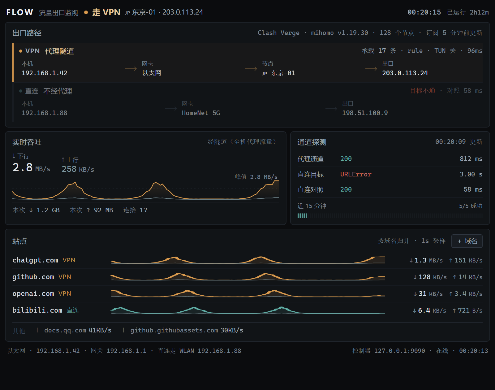
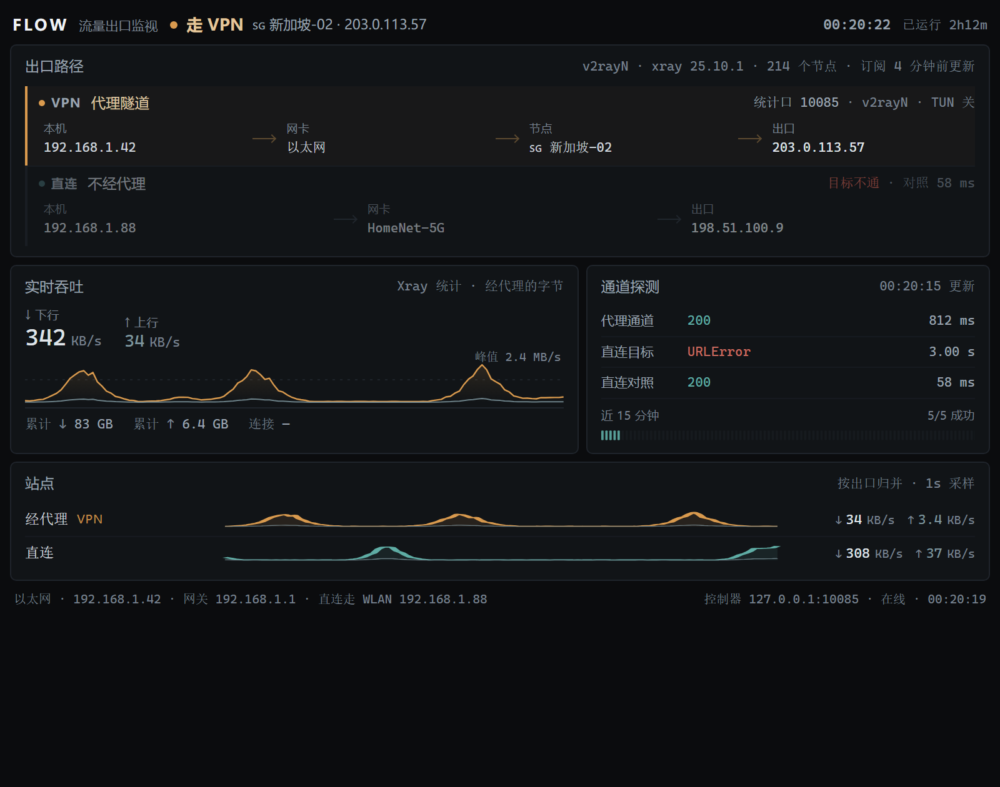

# FLOW · 流量出口监看

一个只在本机跑的小面板，回答一个问题：**这一刻的流量，是走直连，还是走 VPN？走的哪块网卡、从哪个 IP 出去？**

当前版本 **v0.1.1** · 变更见 [CHANGELOG.md](CHANGELOG.md) · Windows 10/11 · 只要 Python 3.10+ 标准库



> 示意图，数据全是我编的：`192.168.1.x` / `203.0.113.x` / `HomeNet-5G` / `Clash Verge` 都是演示值，
> 不是任何人的真实网络。图片由 `tools/mock_state.py` 生成，可复现。

一句话概括它跟"任务管理器看网速"的区别：**它不只知道用了多少流量，还知道这些字节最终从哪条路、哪个 IP 出去，
以及某个域名走的是隧道还是直连**。

---

## 目录

- [一、面板上有什么](#一面板上有什么)
- [二、适配哪些客户端](#二适配哪些客户端自动发现不用配)
- [三、数据从哪来](#三数据从哪来判定的依据)
- [四、跑起来](#四跑起来)
- [五、配置](#五配置configjson)
- [六、HTTP 接口](#六http-接口)
- [七、边界（重要）](#七边界重要)
- [八、隐私](#八隐私)
- [九、目录结构](#九目录结构)
- [十、排障](#十排障)

---

## 一、面板上有什么

### 1. 顶部判定（一句话结论）

| 判定 | 什么时候出现 |
|---|---|
| **走 VPN** | 系统代理开着且指向客户端本地端口；或 TUN 已接管全部流量 |
| **部分走 VPN** | 客户端在跑，但系统代理没开（或它是不暴露控制器的客户端）—— 只有自己显式配了代理的程序走隧道 |
| **直连** | 系统代理没开、TUN 没接管，也没有程序在用隧道，路由层面就是直接出去 |
| **隧道异常** | 控制器不响应，或系统代理指向一个没人监听的端口 |

副标题是关键坐标（`JP 东京-01 · 203.0.113.24` = 节点 + 隧道出口 IP），
下面一行灰字写判定依据，比如"系统代理已开启并指向 127.0.0.1:7890（mihomo rule 模式），代理感知型应用全部经隧道转发"。

判定是**读状态得出的**，不是猜：系统代理开关来自注册表，模式/TUN 来自控制器 API，客户端身份来自端口归属与进程表。

### 2. 出口路径（两条泳道）

```
VPN  代理隧道   本机 ── 网卡 ── 节点 ── 出口        承载 17 条 · rule · TUN 关 · 96ms
直连 不经代理   本机 ── 网卡 ── 出口              目标不通 · 对照 58 ms
```

- **VPN 泳道**：本机 IP → 实际承载隧道的网卡 → 客户端当前在用的节点 → 隧道出口公网 IP
- **直连泳道**：本机 IP → 直连走的那块网卡 → 直连出口公网 IP；
  右上角"目标不通 + 对照 58ms"是**反证**：同一个目标直连不通、国内对照点 58ms 通，
  说明"网是好的，只是这个目标需要代理"，而不是"网卡坏了"
- **网卡是按内核路由判的**：拿目标地址 `connect()` 一次，看内核给我选哪个源地址，再反查成网卡名 —— 不是按网卡名、也不是按默认路由猜

两块网卡不一样时（有线打隧道、Wi-Fi 走直连），两条泳道会显示不同网卡，页脚还会写一句
`直连走 WLAN 192.168.1.88`。双上行是最容易被忽略的状态，也是"为什么某个程序很慢"的常见答案。

### 3. 实时吞吐

1 秒一帧，画 120 秒内的 ↓↑ 曲线，配本次累计和连接数。
数据是客户端内核统计到的**全机代理流量**，不是某一块网卡的总量 —— 所以它不会把局域网拷贝算进去。

### 4. 通道探测

每 10 秒，分别从**代理通道**和**直连通道**访问同一个目标（默认 ChatGPT），给出状态码和耗时；
最下面一条刻度是最近 96 次探测的健康记录，失败会标红。第三行"直连对照"打的是国内站点，
用来把"目标不通"和"网络不通"分开。

### 5. 站点

按域名归并的实时速率（↓↑）+ 走的是 VPN 还是直连，行的颜色跟着实际出口走（琥珀=VPN、青=直连）。
底部一行是其余正在跑流量的域名（最多 4 个），**点一下 ＋ 就把它加到监测列表**。

> 客户端不暴露连接表时（比如 v2rayN），这一栏会变成"经代理 / 直连"两行**出口级**流量，
> `＋ 域名` 自动收起 —— 没有逐域名数据就明说没有，不拿总数去凑一个域名。见[第二节](#二适配哪些客户端自动发现不用配)。

### 6. 自己加要盯的域名

右上角「＋ 域名」→ 敲 `github.com` 回车即生效（写回 `config.json`，重启还在）。
随手贴 `https://www.github.com/path` 也行，会自动取成 `github.com`。
鼠标移到站点行上，右侧出现 `×`，点掉就不再盯它。
写错了在底部弹一行提示（`看起来不是个域名`），不会污染配置。

---

## 二、适配哪些客户端（自动发现，不用配）

### 1. 发现流程

面板不认死某一家软件。启动后它自己走这条链：

1. **谁在监听**：`netstat -ano` 拿本机监听端口 → 端口归属哪个 PID
2. **是不是 Clash 系**：对这些端口探 `GET /version`，能回 `{"version": …}` 的就是 **Clash REST API**
   （mihomo / Clash Verge / ClashX Meta / Mihomo Party / FlClash / sing-box 的 `clash_api` 都符合）
3. **配置在哪**：读内核进程命令行，抠 `-f / -c / --config / -d`；抠不到就按约定猜
   （`guiConfigs/config.json`、`config.json`、`profiles/*.yaml` 之类）
4. **解析配置**：`proxies:`（YAML）/ `outbounds`（JSON）→ 节点表、节点数、内容指纹；
   Xray 系还多认两样：`metrics.listen`（统计口）和 `inbound` 里的本地代理口

全程只读，不改任何系统/代理配置。

### 2. 支持矩阵

| 客户端 | 怎么认 | 判定 | 节点名 | 逐条连接 | 字节流量 |
|---|---|---|---|---|---|
| Clash Verge / Mihomo Party / FlClash / Clash for Windows / 自编译 mihomo / 机场定制客户端 | Clash API + 配置 | ✅ | ✅ | ✅ | ✅ 按域名 |
| sing-box（开了 `clash_api`） | Clash API + JSON 配置 | ✅ | ✅ | ✅ | ✅ 按域名 |
| **v2rayN（Xray 内核）** | 进程 + 它生成的 `guiConfigs/config.json` + 统计口 | ✅ | ✅ 读 `guiNDB.db` 的备注 | ❌ 内核不提供 | ✅ **按出口**（经代理 / 直连） |
| 其它 Xray 壳（NekoRay、自写启动器） | 进程 + 配置 | ✅ | 认不到就显示地址 | ❌ | 有统计口才有 |
| WireGuard / OpenVPN / 深信服 / Tailscale | 进程 + 网卡 | ✅ | ❌ | ❌ | ❌ 只有网卡与出口 |
| 没见过的客户端（比如只叫 `proxy.exe`） | 进程名 | ✅ | ❌ | 看它是不是 Clash 系 | 同上 |

**三种可见度，面板会如实告诉你现在是哪一种**：

- **连接级**（Clash 系）：知道每条连接走没走代理、走了哪个节点、属于哪个域名 —— 站点卡按域名
- **出口级**（v2rayN / Xray）：只知道"经代理的字节"和"直连的字节"各多少 —— 站点卡按出口
- **只有网卡**（WireGuard 等）：只有出口 IP 和网卡判定，站点卡空着并说明原因

### 3. v2rayN 是怎么拿到流量的

v2rayN 为了让自己的界面画实时速率曲线，会往生成的配置里写 `stats: {}`、
`policy.system.statsOutboundUplink/Downlink = true` 和 `metrics.listen = 127.0.0.1:<端口>`
（见它源码里的 `V2rayStatisticService` / `CoreConfigV2rayService`）。

那个统计口是个普通 HTTP 服务，`GET /debug/vars` 回来的 JSON 里就有每个 outbound 的累计字节：

```json
{"stats": {"outbound": {"proxy":  {"uplink": 7000000, "downlink": 88000000},
                        "direct": {"uplink":  300000, "downlink":  2100000}}}}
```

面板对它做 1 Hz 差分，就得到"经代理 / 直连"两条精确曲线。
**精确到字节，但粒度是出口不是域名** —— Xray 不暴露连接表，这一点没得商量。

同一块面板在 v2rayN 下的样子（站点卡换成两行出口级流量，`＋ 域名` 收起）：



> 示意图，数据同样是编的。

节点名同理：v2rayN 把备注存在 `guiConfigs/guiNDB.db`（SQLite）里，
面板拿当前 outbound 的 `地址:端口` 去反查 `remarks`，读不到就退回显示地址。
读库是只读打开（`mode=ro` + `query_only`），2 分钟一次，不锁它的文件。

### 4. 节点名与订阅

**节点一栏显示的是这家软件自己的叫法**（`🇯🇵 东京-01`、`SG-02`），不是 IP。
三级回退：控制器 `now`（GLOBAL / 各 Selector 投票）→ 连接链里的配置名 → 出口 IP 反查配置里的 `server`。

**订阅更新**：Clash 系直接读 `/providers/proxies`，拿订阅名、上次更新时间、已用流量、到期时间；
把订阅拉平成一个大 yaml 的客户端，则盯配置文件的内容指纹 —— 节点表一变，
"订阅 X 分钟前更新"立刻刷新，节点名也重新解析。

---

## 三、数据从哪来（判定的依据）

| 事实 | 来源 |
|---|---|
| 系统代理开关 / 地址 | 注册表 `HKCU\Software\Microsoft\Windows\CurrentVersion\Internet Settings` 的 `ProxyEnable` / `ProxyServer` |
| 客户端是谁、控制器在哪 | `netstat` 端口归属 + WMI 进程表；控制器地址自动发现，`config.json` 里的只是提示 |
| 什么模式、TUN 开没开、节点表 | 控制器 `/configs`、`/version`，加上内核命令行指向的配置文件 |
| 当前节点叫什么 | 控制器 `now`（GLOBAL / Selector 投票）→ 连接链；问不到就用出口 IP 反查配置里的 `server` |
| 每条连接走没走代理、走了哪个节点 | `/connections` 的 `chains`（`DIRECT` = 直连） |
| 每个域名的实时速率 | 对 `/connections` 里每条连接的累计字节做 1 Hz 差分，按 `metadata.host` 归并 |
| 经代理 / 直连各多少字节（v2rayN） | Xray 的 `GET /debug/vars` → `stats.outbound[tag]`，同样 1 Hz 差分 |
| Xray 统计口在哪 | 它自己生成的 `config.json` 里的 `metrics.listen`，不用你填 |
| 隧道出口 IP | 经客户端的**本地代理口**访问 `ip-api.com`（120 秒一次）；代理口从配置里读（Clash 系 7890、v2rayN 常见 10808） |
| 直连出口 IP | 绕过代理访问 `ip-api.com`（300 秒一次） |
| 走的哪块网卡 | `socket.connect()` 问内核"去这个目的地选哪个源地址"，再反查网卡 |
| Wi-Fi 细节（SSID / 频段 / 信号 / 速率） | `netsh wlan show interfaces`（中英文系统都能解析） |
| 网卡地址 / 网关 / 接口度量 | `netsh interface ipv4 show addresses` |

所有采集都在本机完成。唯一的外网请求是**出口 IP 探测**（`ip-api.com`）和**通道探测**（你配的那个目标）。

---

## 四、跑起来

### 1. 要求

- Windows 10 / 11
- Python 3.10+（**只用标准库**，不需要 `pip install` 任何东西）
- 已装 Edge 或 Chrome（用来开面板窗口）

### 2. 启动 / 停止

```powershell
# 双击 start.cmd 也行
powershell -ExecutionPolicy Bypass -File .\start.ps1

# 关掉采集器
powershell -ExecutionPolicy Bypass -File .\start.ps1 -Stop
```

`start.ps1` 会：后台用 `pythonw` 拉起 `server.py`（无控制台窗口）→ 等端口就绪 →
用 Edge（没有就 Chrome）的 `--app=` **应用窗口模式**开一扇 800×630 的窗口。

参数：

| 参数 | 作用 |
|---|---|
| `-Stop` | 停掉采集器（窗口自己关掉即可） |
| `-Port` | 换端口（默认 7717），会用 `FLOW_PORT` 传给采集器，窗口打开的地址也跟着换 |
| `-Width` / `-Height` | 窗口尺寸（默认 800×630） |
| `-DefaultProfile` | 用你日常浏览器的 profile（默认用仓库里的 `.app-profile/` 独立 profile） |

### 3. 关于那扇窗口

- **没有地址栏、没有标签页、没有书签栏**，标题和任务栏图标都是面板自己的
- 用独立 profile，**不碰你日常浏览器的登录态和历史**；`.app-profile/` 已进 `.gitignore`
- 窗口已经开着时，再跑一次 `start.ps1` 不会开第二扇
- **它不会调用系统默认浏览器**；没装 Edge/Chrome 会直接报错，而不是退回到"打开一个网页"
- 想要纯粹的桌面窗口（不带浏览器的任何痕迹）需要 WebView2 外壳，那会引入第三方依赖，
  与"只用标准库"冲突，所以没做

---

## 五、配置（`config.json`）

```json
{
  "port": 7717,
  "controller": "127.0.0.1:7892",
  "mixed_port": "127.0.0.1:7890",
  "sites": ["chatgpt.com", "openai.com"],
  "probe_interval": 10,
  "probe_target": "https://chatgpt.com/",
  "control_target": "https://www.baidu.com/"
}
```

| 键 | 默认 | 说明 |
|---|---|---|
| `port` | `7717` | 面板监听端口（只绑 127.0.0.1） |
| `controller` | `127.0.0.1:7892` | Clash 控制器地址；**留空就完全自动发现**，填了就先试它 |
| `mixed_port` | `127.0.0.1:7890` | 混合代理口：出口 IP 探测与"代理通道"探测走它。v2rayN 这类会从它自己的配置里读真实端口，这个值只兜底 |
| `sites` | `["chatgpt.com","openai.com"]` | 要单独盯速率的域名，后缀匹配（`chat.openai.com` 算进 `openai.com`） |
| `probe_interval` | `10` | 探测间隔秒数，最小 5 |
| `probe_target` | `https://chatgpt.com/` | 双通道探测打的目标 |
| `control_target` | `https://www.baidu.com/` | 直连泳道里那个"对照"目标 |

环境变量覆盖：`FLOW_PORT`、`FLOW_CONTROLLER`（其余项只认文件）。改完重启采集器生效。

---

## 六、HTTP 接口

面板和采集器之间就是个普通 HTTP，全在 `127.0.0.1` 上：

| 路径 | 内容 |
|---|---|
| `GET /` | 面板（单文件 HTML，内联 CSS/JS，手写 SVG 曲线，无外链 CDN） |
| `GET /api/state` | 当前快照 JSON |
| `GET /api/stream` | SSE，每秒一帧（面板默认用这个） |
| `GET /?poll=1` | 让页面退化成 1 秒轮询（SSE 被中间件挡掉时用） |
| `POST /api/sites` | 增删监测域名：`{"action":"add"\|"remove","domain":"github.com"}`，成功 200、域名不合法 400，返回新的列表 |

快照主要字段：

| 字段 | 内容 |
|---|---|
| `ok` / `error` | 这一帧采到没有 / 为什么没采到 |
| `flow` | `clash`（连接级）或 `xray`（出口级）或空（只有网卡） |
| `path` | `{active, reason, sysproxy}` —— 顶部那句判定和它的依据 |
| `tunnel` | `{up, mode, tun, mixed, controller, version, conns, download_total, upload_total}` |
| `client` | 发现的客户端：`name / kind / core / version / api / config / exe / pid / nodes / sub / metrics / local_proxy` |
| `iface` / `route` | 当前网卡、两条泳道各自走哪块网卡 |
| `node` | 当前节点：`name / server / port / type / rtt` |
| `egress` | 两个出口 IP 与地理位置、最后更新时间 |
| `probes` | `vpn / direct / control` 三路探测结果 |
| `sites` / `extras` | 按域名（或按出口）归并的行 / 其余在跑流量的域名 |
| `hist` | 服务端攒的最近 120 帧（约 2 分钟），面板一打开就有曲线，不用空等 |
| `total` / `watched` | 总速率 / 当前监测列表 |

`tools/peek.py` 是这套接口的命令行查看器（排障时比开面板快）。

---

## 七、边界（重要）

1. **只看得到"客户端说自己转发了多少"。** 系统代理关掉、程序又不认代理时，
   那部分流量在面板里看不见 —— 这时判定会显示"部分走 VPN"，而不是假装知道全部。
2. **粒度取决于客户端。** Clash 系能给到域名；Xray 只到出口；WireGuard 只有网卡和出口 IP。
   面板不会拿总数摊到域名上冒充精确。
3. **"站点"是域名维度，不是进程维度。** 同一域名下多个连接会合并，同一个程序连两个域名会分成两行。
4. **直连泳道是反证，不是某个程序的实际路径。** 它说明"这个目标不走代理通不通"。
5. **出口 IP 每 120 / 300 秒刷新一次**，切节点后最多滞后这么久。
6. **TUN 模式打开时**，"网卡"会变成 TUN 虚拟网卡，泳道展示的是隧道入口而非物理出口。
7. **采集器只读**：不改系统代理、不改路由、不动任何客户端配置，杀掉它什么都不影响。
8. **v2rayN 适配的依据是它生成配置的格式**，用构造样本 + 假统计口验证过，
   没有覆盖 v2rayN 的所有版本；`guiNDB.db` 表结构变过，反查失败只会退回显示地址，不影响流量。
9. **只有 Windows。** 依赖注册表、WMI、`netsh`、`GetIfTable2` 这些 Win32 接口。

---

## 八、隐私

- **只监听 `127.0.0.1`**，没有对外端口，同一局域网里的别人连不上
- **只读本机状态**：注册表、进程表、网卡统计、配置文件；配置文件和 SQLite 都是只读打开
- **外网请求只有两类**：出口 IP 探测（打 `ip-api.com`）和通道探测（打你自己配的目标）。
  两者都带完整 URL 但**不带任何身份信息**
- **不写日志文件**：采集器跑在 `pythonw` 下没有控制台，运行时除了 `state.json`（每个域名的累计字节）
  和浏览器 profile 目录，不落任何东西
- **不收集、不上传**任何数据。面板本身也不引外链（无 CDN、无字体、无统计脚本）
- 想彻底断网看面板也行：出口探测失败只是显示"待测"，其余功能照常

---

## 九、目录结构

```
server.py            采集 + HTTP/SSE 服务（标准库，单文件）
providers.py         客户端自动发现 / 配置解析 / 订阅感知 / Xray 统计口
web/index.html       面板（单文件，内联 CSS/JS，手写 SVG 曲线）
start.ps1            启动器（后台起服务 + 应用窗口打开面板）
start.cmd            双击入口（转调 start.ps1）
config.json          配置
CHANGELOG.md         变更记录
docs/panel.png       README 示意图（Clash 结构，演示数据）
docs/panel-xray.png  README 示意图（v2rayN 结构，演示数据）
tools/peek.py        命令行看一眼当前快照（排障用）
tools/mock_state.py  生成示意图用的假数据服务（`MOCK_XRAY=1` 切换成 v2rayN 结构）
tools/test_xray.py   v2rayN / Xray 适配的自检（不需要装 v2rayN）
state.json           每个站点的累计流量（自动生成，已 gitignore）
.app-profile/        面板窗口用的独立浏览器 profile（自动生成，已 gitignore）
```

---

## 十、排障

| 现象 | 原因 / 怎么办 |
|---|---|
| 面板说"本地控制器没有响应" | 客户端没开，或它没开 REST API。Clash 系在设置里勾上"外部控制"即可；不支持的客户端只能看到网卡与出口 |
| 判定是"部分走 VPN" | 客户端在跑但系统代理没开：要么在客户端里打开系统代理，要么这就是实话（只有显式配代理的程序走隧道） |
| 站点一直是 `0 B/s` | 该域名这 1 秒没有流量；或流量本来就走了直连（直连流量在 Clash 系客户端里通常不计入统计） |
| v2rayN 模式显示"统计口没响应" | 你的 v2rayN 版本没写 `metrics.listen`，或那个端口被占用。面板会重试，不影响判定 |
| 节点一栏是地址不是名字 | 配置里反查不到备注（v2rayN 看 `guiNDB.db`，Clash 看 yaml 的 `name`）。退回到地址是设计好的兜底 |
| 端口 7717 被占用 | 换端口：`-Port 7718`，或改 `config.json` 的 `port` |
| 点了 `start.ps1` 没反应 | 先看是不是已经开着（会直接退出）；再确认装了 Edge 或 Chrome；PowerShell 5.1 下 `.ps1` 若存成**无 BOM 的 UTF-8**，中文会被按 GBK 解析导致语法错 —— 用编辑器另存为 "UTF-8 with BOM" |
| 面板不刷新 | SSE 被拦（某些安全软件）时，用 `http://127.0.0.1:7717/?poll=1` 退化成轮询 |
| 窗口里一片空白 | 面板文件缺失或采集器没起来：直接浏览器开 `http://127.0.0.1:7717/api/state` 看有没有 JSON |

---

## 十一、版本与变更

版本号按语义化来：`主.次.修订`。当前 **v0.1.1**，完整记录见 [CHANGELOG.md](CHANGELOG.md)。

- `v0.1.1`：多客户端自动发现（Clash 系 / sing-box / v2rayN / WireGuard 等）、节点名解析、订阅感知、
  界面重做、独立应用窗口、v2rayN 出口级流量
- `v0.1.0`：首个版本，只认 mihomo 的单一客户端版本
